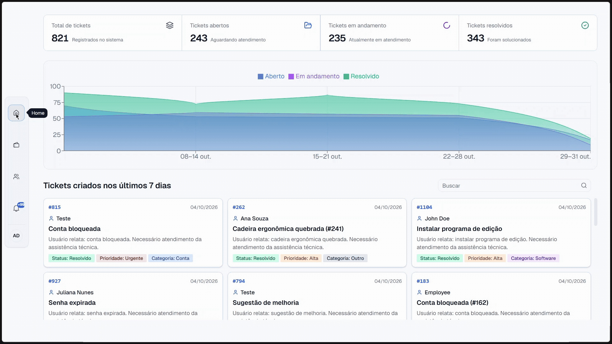
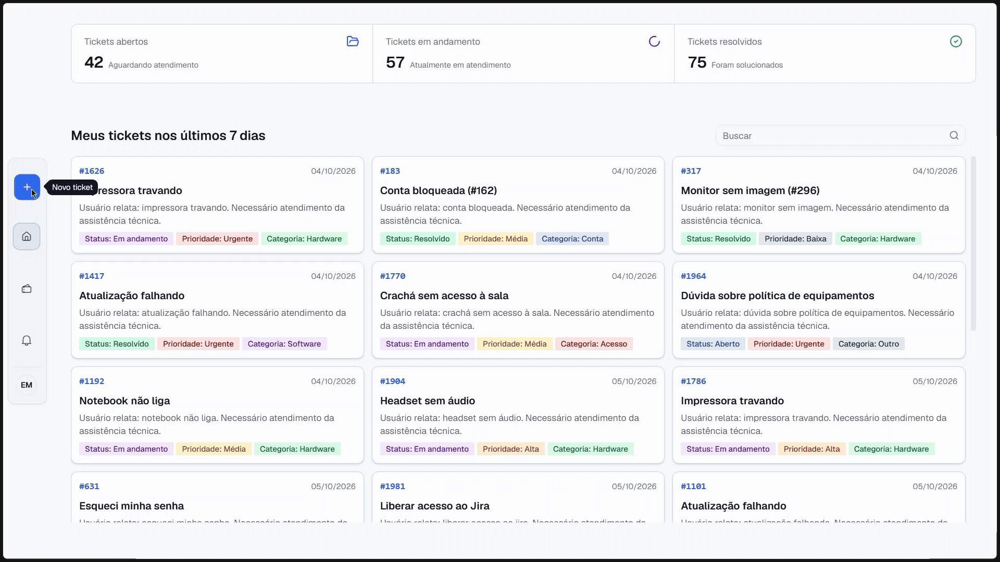
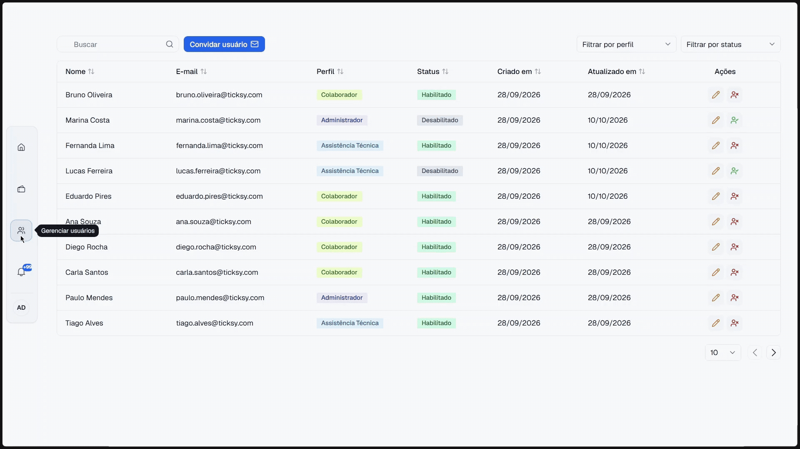
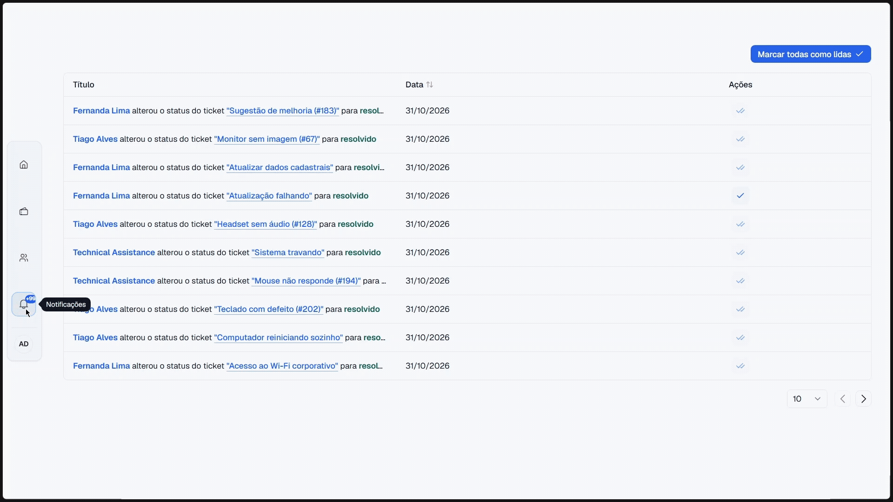
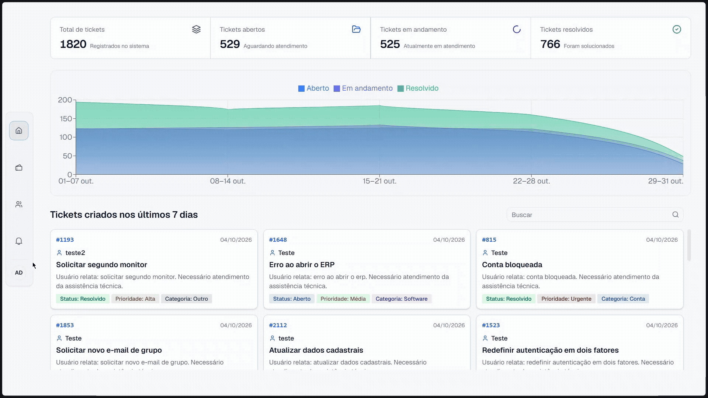

<p align="center">
  <b>Português</b> | <a href="https://github.com/rafaznj/ticksy/blob/main/README.md">English</a>
</p>

# Ticksy

Sistema de help desk para criar, atribuir e acompanhar tickets de suporte, com dashboard de métricas e notificações.

<p align="center">
  <picture>
    <source media="(prefers-color-scheme: dark)" srcset="frontend/src/assets/images/black-theme/home.gif">
    
  </picture>
</p>

## Sobre

O Ticksy é um sistema de help desk full-stack que cobre todo o ciclo de vida de um ticket: criação, atribuição e mudança de status. Cada etapa gera notificações para as pessoas envolvidas, e o acesso às telas e ações varia conforme o perfil do usuário.

<p align="center">
  
  
  
  
  
</p>

## Como surgiu a ideia

O Ticksy nasceu como um projeto pessoal para construir uma aplicação completa de ponta a ponta: autenticação, modelagem de dados relacional, API tipada, frontend moderno e deploy real. Um help desk foi uma ótima escolha porque reúne naturalmente perfis de usuário, mudanças de estado, dashboards e notificações.

## Perfis de usuário

| Perfil | O que faz |
| --- | --- |
| `employee` | Abre tickets e acompanha o andamento dos seus próprios chamados |
| `technical_assistance` | Recebe os tickets atribuídos a ele e marca como resolvidos |
| `admin` | Gerencia usuários, atribui tickets e acompanha as métricas do sistema |

## Funcionalidades

### Home

Todos os perfis veem cards com a quantidade de tickets por status e a lista dos tickets criados pelo próprio usuário nos últimos sete dias.

No painel do admin, a Home também traz gráficos com a distribuição dos tickets por status e a lista de todos os tickets criados nos últimos sete dias.

<p align="center">
  <picture>
    <source media="(prefers-color-scheme: dark)" srcset="frontend/src/assets/images/black-theme/home.gif">
    
  </picture><br>
  <sub><b>Home</b></sub>
</p>

### Criar ticket

Formulário para abrir um novo chamado, disponível para o perfil `employee`.

<p align="center">
  <picture>
    <source media="(prefers-color-scheme: dark)" srcset="frontend/src/assets/images/black-theme/create-ticket.gif">
    
  </picture><br>
  <sub><b>Criar ticket</b></sub>
</p>

### Tickets

Listagem paginada dos tickets, com atribuição a técnicos, remoção de atribuição, edição, exclusão e resolução, de acordo com o perfil de cada usuário.

<p align="center">
  <picture>
    <source media="(prefers-color-scheme: dark)" srcset="frontend/src/assets/images/black-theme/tickets.gif">
    
  </picture><br>
  <sub><b>Tickets</b></sub>
</p>

### Usuários

Área do admin para listar, ativar, desativar e visualizar os usuários do sistema.

<p align="center">
  <picture>
    <source media="(prefers-color-scheme: dark)" srcset="frontend/src/assets/images/black-theme/users.gif">
    
  </picture><br>
  <sub><b>Usuários</b></sub>
</p>

### Notificações

As notificações são tipadas (`ticket_created`, `ticket_assigned`, `ticket_unassigned`, `ticket_status_changed`), entregues individualmente aos destinatários, em tempo real via SSE (Server-Sent Events), e com controle de leitura por usuário.

- **Admin:** é avisado quando um ticket é criado e quando é resolvido.
- **Assistência técnica:** é avisada quando um ticket é atribuído a ele.
- **Funcionário:** é avisado quando o status do seu ticket muda e quando ele é resolvido.

<p align="center">
  <picture>
    <source media="(prefers-color-scheme: dark)" srcset="frontend/src/assets/images/black-theme/notifications.gif">
    
  </picture><br>
  <sub><b>Notificações</b></sub>
</p>

### Sidebar

Permite editar o perfil do usuário e alternar entre os temas claro e escuro e entre os idiomas português e inglês.

<p align="center">
  <picture>
    <source media="(prefers-color-scheme: dark)" srcset="frontend/src/assets/images/black-theme/sidebar.gif">
    
  </picture><br>
  <sub><b>Sidebar</b></sub>
</p>

## Como acessar

**Teste online:** [https://ticksy.rafaelsena.dev](https://ticksy.rafaelsena.dev)

Ou rode localmente seguindo as instruções abaixo.

## Rodando localmente

O projeto é um monorepo com pnpm: as dependências são instaladas uma única vez, na raiz.

```bash
# 1. Clone o repositório
git clone https://github.com/rafaznj/ticksy.git

# 2. Entre na pasta do projeto
cd ticksy

# 3. Instale as dependências (na raiz do monorepo)
pnpm install

# 4. Configure as variáveis de ambiente (veja os arquivos .env.example)

# 5. Rode as migrations (dentro da pasta do backend)
cd backend
pnpm migrate
cd ..

# 6. Rode o frontend e o backend juntos (na raiz)
pnpm dev
```

O frontend ficará disponível em `http://localhost:5173` (porta padrão do Vite).

Para rodar cada parte separadamente, você pode usar os scripts da raiz:

```bash
pnpm dev:frontend
pnpm dev:backend
```

Ou entrar em cada pasta (`frontend/` ou `backend/`) e rodar `pnpm dev`.

## Usuários de teste (seed)

O sistema cria automaticamente três usuários de seed, um para cada perfil, para você explorar o app sem precisar se cadastrar:

| Perfil | Nome | E-mail | Senha |
| --- | --- | --- | --- |
| `employee` | Employee | `employee@email.com` | `@Aa12345` |
| `technical_assistance` | Technical Assistance | `technical_assistance@email.com` | `@Aa12345` |
| `admin` | Administrator | `admin@email.com` | `@Aa12345` |

## Documentação da API (Swagger)

A API do backend é documentada com Swagger, e você pode explorar e testar os endpoints direto pelo navegador:

- **Local:** acesse `/docs` no endereço em que o backend estiver rodando (por exemplo, `http://localhost:4002/docs`)
- **Produção:** [https://ticksy-backend-sapr.onrender.com/docs](https://ticksy-backend-sapr.onrender.com/docs)

## Estrutura

```
.
├── frontend/
│   └── src/
│       ├── assets/
│       │   └── images/
│       │       ├── light-theme/                            # GIFs do README (tema claro)
│       │       └── black-theme/                            # GIFs do README (tema escuro)
│       ├── components/
│       │   ├── auth/                                       # AuthCarousel
│       │   ├── dashboard/                                  # Métricas de Admin, Employee e Technical Assistance
│       │   ├── form/                                       # Campos dos formulários (TanStack Form)
│       │   ├── layouts/                                    # Sidebar
│       │   ├── preferences/                                # Alternância de tema e idioma
│       │   ├── tables/                                     # Infinite list, paged table e tabelas de users, tickets e notifications
│       │   └── ui/                                         # Componentes primitivos do shadcn/ui
│       ├── forms/                                          # Todos os formulários do sistema
│       │   ├── auth/
│       │   ├── tickets/
│       │   └── users/
│       ├── hooks/
│       ├── infrastructure/                                 # Interceptors
│       ├── lib/                                            # Definições, tipagens e container de injeção de dependência (Inversify) das libs utilizadas
│       ├── modules/                                        # Services, repositories, query hooks, enums, DTOs e tipagens das entidades
│       │   ├── auth/
│       │   ├── tickets/
│       │   ├── users/
│       │   └── notifications/
│       ├── pages/                                          # Todas as páginas do sistema
│       ├── routes/                                         # Rotas do sistema
│       └── shared/                                         # Arquivos compartilhados
|
|
├── backend/                                             
│   ├── .env.example                                        # Exemplo de como devem ser as variáveis de ambiente
│   ├── setup.ts                                            # Script de setup do projeto
│   └── src/
│       ├── database/
│       │   ├── config.ts                                   # Configuração da conexão com o banco
│       │   ├── tokens.ts                                   # Tokens de injeção do banco
│       │   └── drizzle/
│       │       ├── migrations/                             # Migrations SQL e metadados
│       │       ├── schema/                                 # Tabelas: users, tickets, notifications, notification-recipients e refresh-tokens
│       │       └── utils/                                  # Utilitários (ex.: to-pg-enum)
│       ├── modules/                                       
│       │   ├── auth/                                       # Autenticação JWT: login, registro, refresh e logout
│       │   ├── ticket/                                     # Criação, atribuição, resolução e consultas de tickets
│       │   ├── user/                                       # Gestão de usuários: cadastro, ativação, desativação e convite
│       │   └── notification/                               # Notificações: criação, listagem, contagem e marcação como lida
│       └── shared/                                         # Código compartilhado entre os módulos
│           ├── base/                                       # Repositories e services genéricos reutilizados pelos módulos
│           ├── config/                                     # Configuração do JWT e do Swagger
│           ├── di/                                         # Tokens de injeção de dependência de repositories e services
│           ├── exceptions/                                 # Exceção customizada da aplicação
│           ├── filters/                                    # Filtro global de exceções
│           ├── interfaces/                                 # Tipos compartilhados (respostas, erros, paginação e opções de consulta)
│           └── utils/                                      # Helpers de paginação, ordenação, filtros, respostas, cookie de refresh e geração de senha
|
├── eslint.config.js                                        # ESLint (flat config) na raiz do monorepo
```

## Ideias de melhoria

- [ ] Workspaces: um espaço isolado para cada organização, com seus próprios usuários, tickets e métricas
- [ ] Comentários e histórico de alterações em cada ticket
- [ ] Anexos de imagens e arquivos nos tickets
