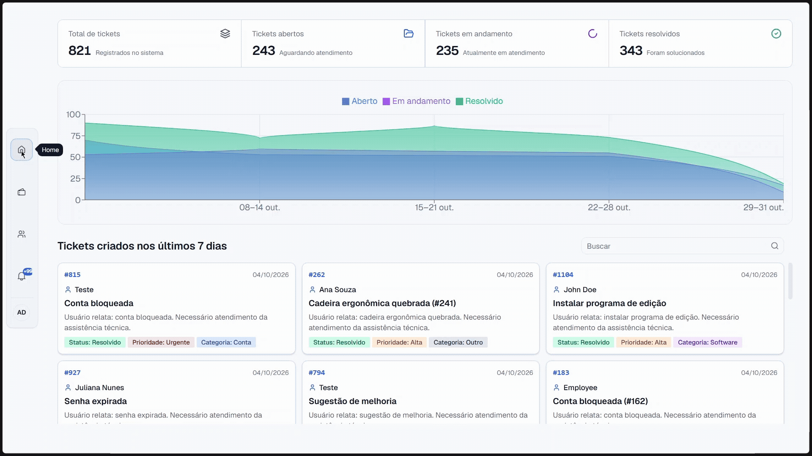
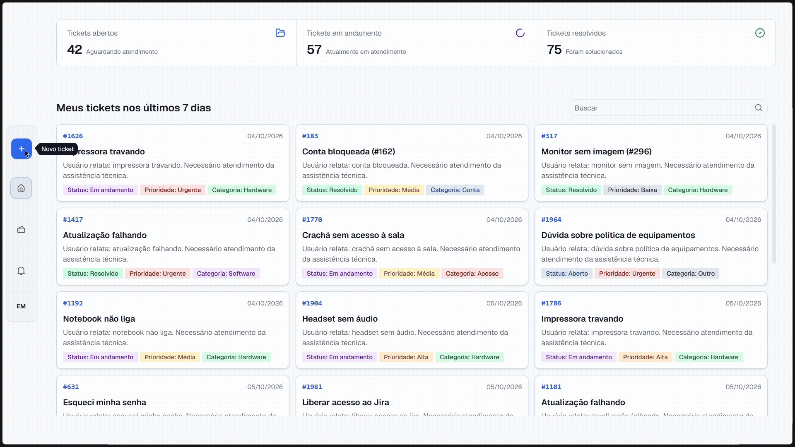
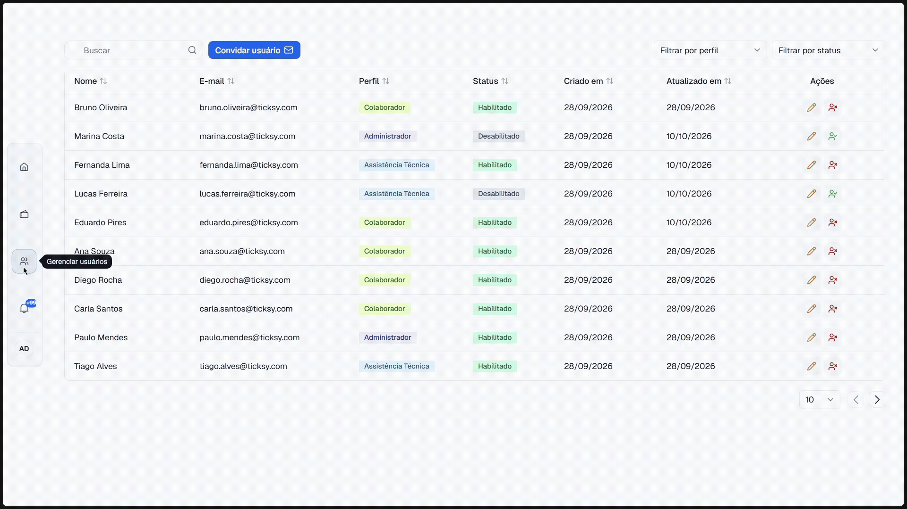
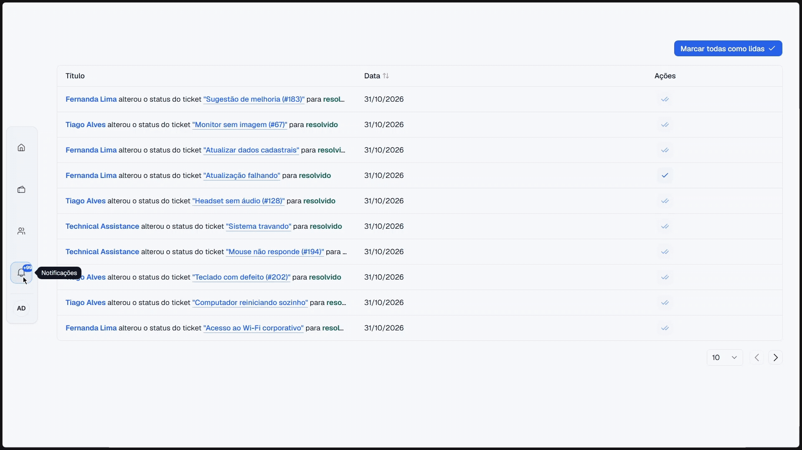
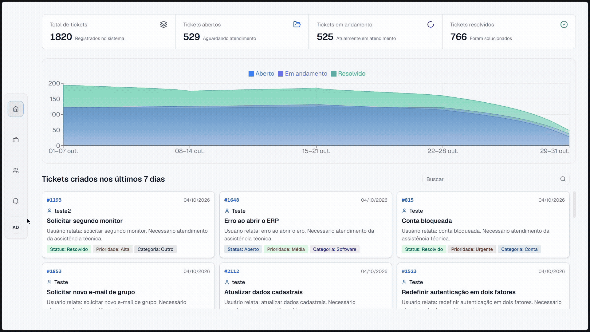

<p align="center">
  <a href="https://github.com/rafaznj/ticksy/blob/main/README-pt-br.md">Português</a> | <b>English</b>
</p>

# Ticksy

A help desk system to create, assign and track support tickets, with a metrics dashboard and notifications.

<p align="center">
  <picture>
    <source media="(prefers-color-scheme: dark)" srcset="frontend/src/assets/images/black-theme/home.gif">
    
  </picture>
</p>

## About

Ticksy is a full-stack help desk system that covers the whole ticket lifecycle: creation, assignment and status changes. Every step generates notifications for the people involved, and access to screens and actions varies according to the user's profile.

<p align="center">
  
  
  
  
  
  
  
</p>

## How the idea came about

Ticksy started as a personal project to build a complete application end to end: authentication, a relational data model, a typed API, a modern frontend and a real deployment. A help desk was a great fit because it naturally brings together user profiles, state changes, dashboards and notifications.

## User profiles

| Profile | What it does |
| --- | --- |
| `employee` | Opens tickets and follows the progress of their own requests |
| `technical_assistance` | Receives the tickets assigned to them and marks them as resolved |
| `admin` | Manages users, assigns tickets and follows the system's metrics |

## Architecture & Design Decisions

Ticksy was architected with a strong focus on **SOLID principles**, **Clean Architecture**, and **decoupling**, ensuring maintainability, testability, and high coherence across both the backend and frontend.

### Backend Architecture (NestJS)

- **Domain-Driven Modular Monolith:** Organized into bounded business domains (`auth`, `ticket`, `user`, `notification`). Each module manages its own controllers, services, repositories, DTOs, and view models.
- **Dependency Inversion Principle (DIP):** Services and repositories are decoupled from implementations via explicit TypeScript interfaces and unique dependency injection tokens (`SERVICE_TOKENS` and `REPOSITORY_TOKENS`). Modules interact through contracts rather than concrete classes.
- **Single Responsibility Principle (SRP):** Business logic resides in granular, single-purpose services exposing a standardized `execute(...)` method (e.g., `AssignTicketService`, `LoginService`, `AutoAssignTicketService`).
- **Repository Pattern with Drizzle ORM:** Data access is abstracted through dedicated repository classes using Drizzle ORM, providing end-to-end type safety (`type-safe SQL`), zero schema duplication, and near-native SQL performance without heavy ORM overhead.
- **Scheduled Background Tasks (Cron Jobs):** Built with `@nestjs/schedule`. Jobs act as adapters/entrypoints (similar to controllers) that trigger domain services without embedding business logic inside the scheduler. For example, `AutoAssignTicketsJob` executes daily to balance unassigned tickets across technical assistants respecting a Work-In-Progress (WIP) limit of 5 active tickets per technician.
- **Real-Time Delivery via SSE:** Server-Sent Events (SSE) provide lightweight, unidirectional real-time updates for typed user notifications (`ticket_created`, `ticket_assigned`, etc.) without WebSocket overhead.
- **Centralized Error Handling:** Domain-specific exceptions (`AppException`) are intercepted by a `GlobalExceptionFilter`, standardizing error structures and HTTP status codes across the entire API.

### Frontend Architecture (React)

- **Client-Side Dependency Injection (InversifyJS):** Services and API repositories in `modules/` are managed by an InversifyJS container, decoupling data fetching and business rules from React UI components.
- **Server State & Caching (TanStack Query):** Data fetching, query caching, background refetching, and pagination state are handled via TanStack Query.
- **Client State (Zustand):** Lightweight global state for user session and authentication tokens (`useAuthStore`).
- **Type-Safe Routing (TanStack Router):** Declarative, strongly-typed routing with built-in search param validation and route guards for authenticated layouts.
- **Accessible UI & Design System:** Built on Tailwind CSS, Radix UI primitives, and shadcn/ui with dark/light theme switching (`next-themes`) and multi-language support (English/Portuguese via `i18next`).

---

## Unit Testing

The project employs **Jest** with `@nestjs/testing` for isolated, lightning-fast unit tests focusing on core business rules and security.

### Testing Strategy

- **Co-located Layer Tests:** Unit tests are located in dedicated `__tests__/` subfolders within each layer (e.g., `src/modules/ticket/services/__tests__/assign.service.spec.ts`), keeping test files organized without cluttering production source directories.
- **DI Resolution Verification:** Tests build an in-memory `TestingModule` to validate that NestJS dependency injection resolves tokens (`SERVICE_TOKENS`, `REPOSITORY_TOKENS`) properly with mocked contracts.
- **Mocking & Isolation:** External dependencies (database repositories, notification dispatchers, and cryptography engines like `argon2`) are fully mocked with `jest.fn()` and `jest.mock()`. This eliminates database dependencies and ensures tests run in milliseconds.
- **Separation of Unit vs. E2E:**
  - `src/**/__tests__/*.spec.ts`: Unit tests testing business logic, exceptions, and side effects in milliseconds.
  - `backend/test/*.e2e-spec.ts`: End-to-end integration tests using `supertest` against a real NestJS application server.

### Running Tests

```bash
# Enter backend directory
cd backend

# Run all unit tests
pnpm test

# Run unit tests in watch mode
pnpm test:watch

# Run unit tests with code coverage report
pnpm test:cov

# Run E2E integration tests
pnpm test:e2e
```

---

## Features

### Home

Every profile sees cards with the number of tickets per status and a list of the tickets the user created in the last seven days.

On the admin dashboard, Home also shows charts with the distribution of tickets by status and a list of all tickets created in the last seven days.

<p align="center">
  <picture>
    <source media="(prefers-color-scheme: dark)" srcset="frontend/src/assets/images/black-theme/home.gif">
    
  </picture><br>
  <sub><b>Home</b></sub>
</p>

### Create ticket

A form to open a new request, available to the `employee` profile.

<p align="center">
  <picture>
    <source media="(prefers-color-scheme: dark)" srcset="frontend/src/assets/images/black-theme/create-ticket.gif">
    
  </picture><br>
  <sub><b>Create ticket</b></sub>
</p>

### Tickets

A paginated list of tickets, with assignment to technicians, unassignment, editing, deletion and resolution, according to each user's profile.

<p align="center">
  <picture>
    <source media="(prefers-color-scheme: dark)" srcset="frontend/src/assets/images/black-theme/tickets.gif">
    
  </picture><br>
  <sub><b>Tickets</b></sub>
</p>

### Users

Admin area to list, activate, deactivate and view the system's users.

<p align="center">
  <picture>
    <source media="(prefers-color-scheme: dark)" srcset="frontend/src/assets/images/black-theme/users.gif">
    
  </picture><br>
  <sub><b>Users</b></sub>
</p>

### Notifications

Notifications are typed (`ticket_created`, `ticket_assigned`, `ticket_unassigned`, `ticket_status_changed`), delivered individually to recipients in real time via SSE (Server-Sent Events), and tracked as read or unread per user.

- **Admin:** is notified when a ticket is created and when it is resolved.
- **Technical assistance:** is notified when a ticket is assigned to them.
- **Employee:** is notified when the status of their ticket changes and when it is resolved.

<p align="center">
  <picture>
    <source media="(prefers-color-scheme: dark)" srcset="frontend/src/assets/images/black-theme/notifications.gif">
    
  </picture><br>
  <sub><b>Notifications</b></sub>
</p>

### Sidebar

Lets users edit their profile and switch between the light and dark themes and between Portuguese and English.

<p align="center">
  <picture>
    <source media="(prefers-color-scheme: dark)" srcset="frontend/src/assets/images/black-theme/sidebar.gif">
    
  </picture><br>
  <sub><b>Sidebar</b></sub>
</p>

## How to access

**Try it online:** [https://ticksy.rafaelsena.dev](https://ticksy.rafaelsena.dev)

Or run it locally following the instructions below.

## Running it locally

### Option 1: With Docker Compose (Recommended)

The quickest way to spin up the entire stack (PostgreSQL, Backend, and Frontend) in isolated containers:

```bash
# 1. Clone the repository
git clone https://github.com/rafaznj/ticksy.git

# 2. Enter the project folder
cd ticksy

# 3. Set up the backend environment variables
# (you can copy backend/.env.example to backend/.env)
cp backend/.env.example backend/.env

# 4. Start all services with build
docker compose up --build -d
```

Docker will:
- Spin up the **PostgreSQL** database with persistent volume.
- Build the NestJS **Backend**, automatically apply Drizzle migrations, and expose the API on port `4002`.
- Compile the **Frontend** production build and serve it via **Nginx** on port `5173`.

To stop the containers:
```bash
docker compose down
```

---

### Option 2: Manually with pnpm

The project is a pnpm monorepo: dependencies are installed once, at the root.

```bash
# 1. Clone the repository
git clone https://github.com/rafaznj/ticksy.git

# 2. Enter the project folder
cd ticksy

# 3. Install dependencies (at the monorepo root)
pnpm install

# 4. Set up the environment variables (see the .env.example files)

# 5. Run the migrations (inside the backend folder)
cd backend
pnpm migrate
cd ..

# 6. Run the frontend and the backend together (at the root)
pnpm dev
```

The frontend will be available at `http://localhost:5173` (Vite's default port).

To run each part separately, you can use the root scripts:

```bash
pnpm dev:frontend
pnpm dev:backend
```

Or enter each folder (`frontend/` or `backend/`) and run `pnpm dev`.

## Test users (seed)

The system automatically creates three seed users, one for each profile, so you can explore the app without having to sign up:

| Profile | Name | E-mail | Password |
| --- | --- | --- | --- |
| `employee` | Employee | `employee@email.com` | `@Aa12345` |
| `technical_assistance` | Technical Assistance | `technical_assistance@email.com` | `@Aa12345` |
| `admin` | Administrator | `admin@email.com` | `@Aa12345` |

## API documentation (Swagger)

The backend API is documented with Swagger, and you can explore and test the endpoints straight from the browser:

- **Local:** open `/docs` at the address where the backend is running (for example, `http://localhost:4002/docs`)
- **Production:** [https://ticksy-backend-sapr.onrender.com/docs](https://ticksy-backend-sapr.onrender.com/docs)

## Structure

```
.
├── docker-compose.yml                                      # Orchestration of all services (PostgreSQL, Backend, and Frontend)
├── frontend/
│   ├── Dockerfile                                          # Multi-stage frontend build & Nginx production image
│   ├── nginx.conf                                          # Nginx SPA fallback and static caching configuration
│   └── src/
│       ├── assets/
│       │   └── images/
│       │       ├── light-theme/                            # README GIFs (light theme)
│       │       └── black-theme/                            # README GIFs (dark theme)
│       ├── components/
│       │   ├── auth/                                       # AuthCarousel
│       │   ├── dashboard/                                  # Admin, Employee and Technical Assistance metrics
│       │   ├── form/                                       # Form fields (TanStack Form)
│       │   ├── layouts/                                    # Sidebar
│       │   ├── preferences/                                # Theme and language toggles
│       │   ├── tables/                                     # Infinite list, paged table and the users, tickets and notifications tables
│       │   └── ui/                                         # shadcn/ui primitive components
│       ├── forms/                                          # All the system's forms
│       │   ├── auth/
│       │   ├── tickets/
│       │   └── users/
│       ├── hooks/
│       ├── infrastructure/                                 # Interceptors
│       ├── lib/                                            # Definitions, typings and dependency injection container (Inversify) for the libraries in use
│       ├── modules/                                        # Services, repositories, query hooks, enums, DTOs and entity typings
│       │   ├── auth/
│       │   ├── tickets/
│       │   ├── users/
│       │   └── notifications/
│       ├── pages/                                          # All the system's pages
│       ├── routes/                                         # System routes
│       └── shared/                                         # Shared files
|
|
├── backend/
│   ├── .env.example                                        # Example of how the environment variables should look
│   ├── Dockerfile                                          # Multi-stage NestJS API build with automatic migrations
│   ├── setup.ts                                            # Project setup script
│   └── src/
│       ├── database/
│       │   ├── config.ts                                   # Database connection configuration
│       │   ├── tokens.ts                                   # Database injection tokens
│       │   └── drizzle/
│       │       ├── migrations/                             # SQL migrations and metadata
│       │       ├── schema/                                 # Tables: users, tickets, notifications, notification-recipients and refresh-tokens
│       │       └── utils/                                  # Utilities (e.g. to-pg-enum)
│       ├── modules/
│       │   ├── auth/                                       # JWT authentication: login, register, refresh and logout
│       │   ├── ticket/                                     # Ticket creation, assignment, resolution and queries
│       │   ├── user/                                       # User management: creation, activation, deactivation and invitation
│       │   └── notification/                               # Notifications: creation, listing, unread count and mark as read
│       └── shared/                                         # Code shared between modules
│           ├── base/                                       # Generic repositories and services reused by the modules
│           ├── config/                                     # JWT and Swagger configuration
│           ├── di/                                         # Dependency injection tokens for repositories and services
│           ├── exceptions/                                 # Custom application exception
│           ├── filters/                                    # Global exception filter
│           ├── interfaces/                                 # Shared types (responses, errors, pagination and query options)
│           └── utils/                                      # Helpers for pagination, ordering, filters, responses, refresh cookie and password generation
|
├── eslint.config.js                                        # ESLint (flat config) at the monorepo root
```

## Ideas for improvement

- [ ] Workspaces: an isolated space for each organization, with its own users, tickets and metrics
- [ ] Comments and change history on each ticket
- [ ] Image and file attachments on tickets
